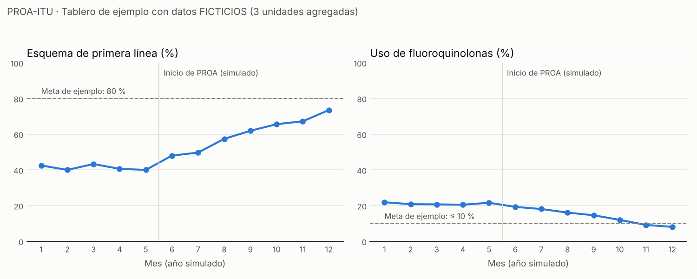

# PROA-ITU · Optimización de antimicrobianos en infección de vías urinarias no complicada (primer nivel de atención)

Marco abierto para instalar y medir un Programa de Optimización de Antimicrobianos (PROA) enfocado en la **cistitis aguda no complicada** en unidades de primer nivel.

**Autor:** Dr. Celedonio Gómez Muñoz · Epidemiología hospitalaria · [Epidemia de Datos](https://epidemiadedatos.substack.com/)
**Licencia:** [CC BY 4.0](LICENSE.md) (puedes reutilizarlo citando la autoría)
**Estado:** borrador de trabajo, versión 0.1

> **Aviso importante.** Este material es de apoyo para programas de calidad y no sustituye el juicio clínico ni las guías oficiales vigentes. Los esquemas deben validarse con el antibiograma local y con la normativa de cada institución antes de usarse. Los datos de este repositorio son **ficticios**: no contienen información de pacientes ni de ninguna institución.

## Qué contiene

| Archivo | Para qué sirve |
|---|---|
| [ALGORITMO.md](ALGORITMO.md) | Algoritmo de decisión para cistitis no complicada: a quién aplica, diagnóstico, cuándo pedir urocultivo, esquemas empíricos y seguimiento |
| [INDICADORES.md](INDICADORES.md) | Seis indicadores PROA con numerador, denominador, fuente de datos y meta de ejemplo |
| [datos_simulados.csv](datos_simulados.csv) | Datos ficticios de tres unidades durante 12 meses, para probar el cálculo |
| [calcular_indicadores.py](calcular_indicadores.py) | Script que calcula los indicadores y genera el tablero de ejemplo |
| [tablero_ejemplo.png](tablero_ejemplo.png) | Tablero de ejemplo generado con los datos ficticios |
| [FUENTES.md](FUENTES.md) | Fuentes consultadas y puntos que cada institución debe validar |

## Tablero de ejemplo (datos ficticios)



## Cómo usarlo

1. Revisa el [algoritmo](ALGORITMO.md) y adáptalo a tu antibiograma local y a tu cuadro básico.
2. Define quién registra los datos y desde qué fuente (receta, expediente o sistema de farmacia).
3. Captura los datos con el formato de `datos_simulados.csv`.
4. Calcula los indicadores:

   ```bash
   python calcular_indicadores.py datos_simulados.csv
   ```

5. Devuelve los resultados a los equipos de forma periódica. La retroalimentación es la parte que más cambia la prescripción.

## Marco de referencia

El enfoque sigue los cuatro elementos básicos de la optimización de antimicrobianos en atención ambulatoria de los CDC (compromiso, acciones de política y práctica, seguimiento y reporte, educación y experiencia). Las referencias completas están en [FUENTES.md](FUENTES.md).

## Resumen en inglés

PROA-ITU is an open framework to set up and measure an outpatient antimicrobial stewardship program focused on acute uncomplicated cystitis in primary care. It includes a decision algorithm, six stewardship indicators with definitions, a script to compute them, and a dashboard example built with entirely synthetic data. It is a working draft and must be validated against local antibiograms and institutional guidelines before use. Author: Dr. Celedonio Gómez Muñoz, hospital epidemiologist, Mexico. License: CC BY 4.0.

## Cómo citar

Gómez Muñoz C. PROA-ITU: optimización de antimicrobianos en infección de vías urinarias no complicada en primer nivel de atención [Internet]. GitHub; 2026. Disponible en: https://github.com/celedoniogomez-epidemiadedatos/proa-itu-primer-nivel

*Del dato al cuidado.*
